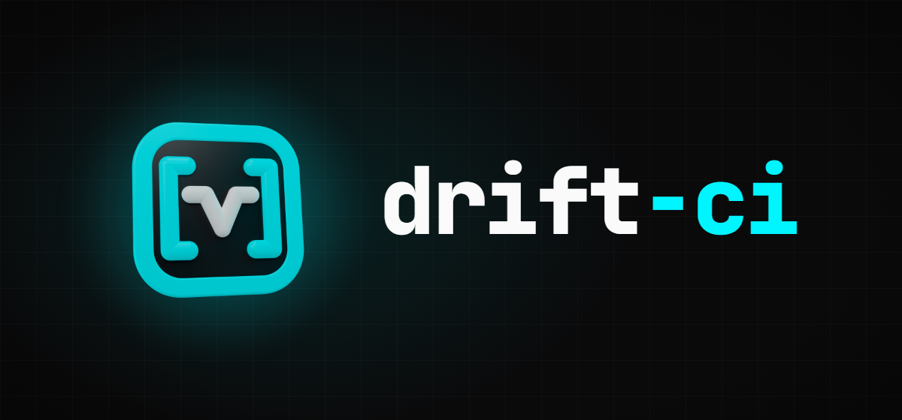
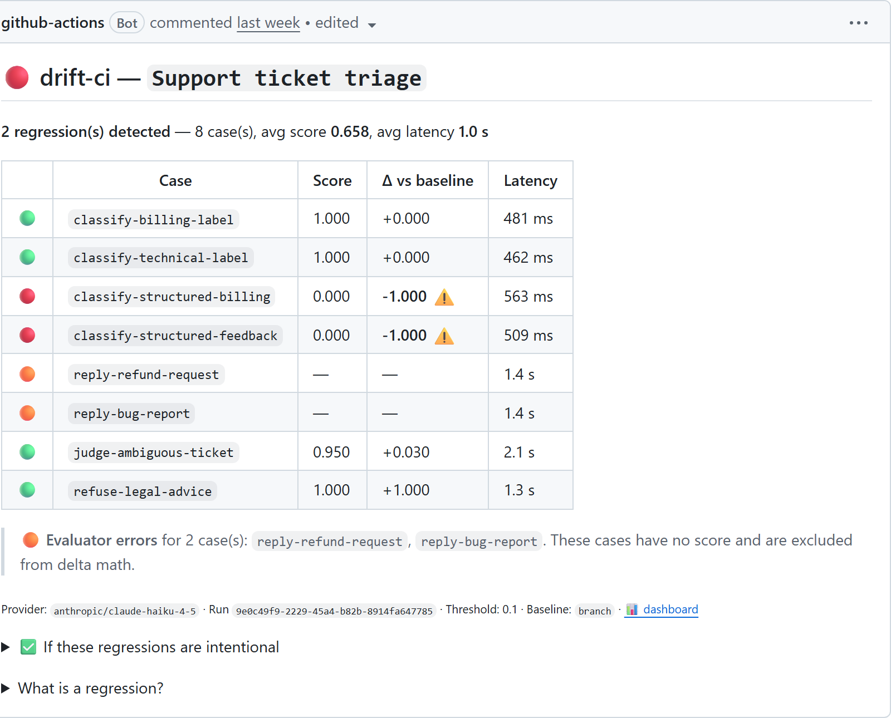
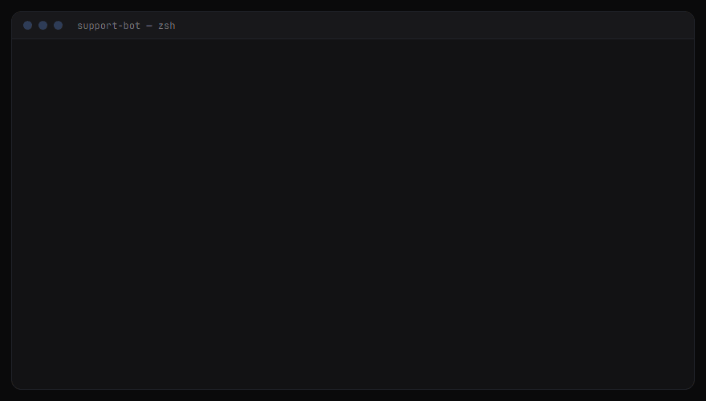

<p align="center">
  
</p>

<h3 align="center">Unit tests for your prompts. A merge gate for your LLM app.</h3>

<p align="center">
  drift-ci runs your LLM test cases on every pull request, compares them with baselines committed to git,<br>
  and blocks the merge when behaviour regresses.
</p>

<p align="center">
  <a href="https://github.com/Drift-CI/drift-ci/actions/workflows/ci.yml"></a>
  <a href="https://www.npmjs.com/package/@drift-ci/cli"></a>
  <a href="https://github.com/marketplace/actions/drift-ci"></a>
  <a href="LICENSE"></a>
</p>

<p align="center">
  <a href="#quick-start">Quick start</a> ·
  <a href="#github-action">GitHub Action</a> ·
  <a href="#why-drift-ci">Why drift-ci</a> ·
  <a href="#writing-tests">Writing tests</a> ·
  <a href="https://drift-ci.com">Hosted dashboard</a>
</p>

---

A reworded prompt, a model upgrade or a bumped SDK can quietly change what your app says. Code has compilers and unit tests to catch that kind of change. Prompts usually don't.

drift-ci adds that check to your pull requests:

<p align="center">
  <picture>
    <source media="(prefers-color-scheme: dark)" srcset="assets/pr-comment-dark.png">
    
  </picture>
  <br>
  <sub>A real run: moving a support agent to a cheaper model broke its structured output. drift-ci failed the check and blocked the merge (<a href="https://github.com/John-E5/drift-ci-dogfood/pull/14">see the PR</a>).</sub>
</p>

## Quick start

You need Node.js 22 or later.

```bash
npx @drift-ci/cli init        # writes .drift/config.yaml and .drift/suite.yaml
npx @drift-ci/cli run         # runs the suite against your provider
npx @drift-ci/cli baseline accept .drift/suite.yaml --all
git add .drift && git commit -m "Add drift-ci baselines"
```

That's the whole loop. From now on, every run is compared with those baselines.

<p align="center">
  
  <br>
  <sub>Real CLI output, using the built-in mock provider so the demo runs without an API key.</sub>
</p>

## GitHub Action

```yaml
# .github/workflows/drift.yml
on: pull_request
permissions:
  contents: read
  pull-requests: write
jobs:
  drift:
    runs-on: ubuntu-latest
    steps:
      - uses: actions/checkout@v6
      - uses: Drift-CI/drift-ci@v1
        with:
          provider: anthropic
          api-key: ${{ secrets.ANTHROPIC_API_KEY }}
        env:
          GITHUB_TOKEN: ${{ secrets.GITHUB_TOKEN }}
```

On each pull request the action runs your suite, fails the check if anything regressed, and posts one comment with the results. The comment is updated in place rather than reposted. It also writes JUnit XML for your CI's test view.

See the [action README](packages/action/README.md) for every input and output, and [examples/workflows/](examples/workflows/) for ready-made setups: basic, multi-provider matrix, fork-safe, and GitLab CI.

## Why drift-ci

### It blocks the merge

Reports are easy to ignore. drift-ci exits `1` when a case regresses past your threshold, so a required check stops the PR. Your normal branch protection does the rest.

### Baselines are code

Expected behaviour lives in `.drift/baseline/<case-id>.json`, committed next to the prompt it describes. When a change is intentional, you accept the new baseline and commit it in the same PR, so reviewers see the code change and the behaviour change in one diff. There is no server state to promote and no button to click.

### It doesn't cry wolf

A gate that fails at random gets switched off. drift-ci is built so that a red check means something:

- **Repeated sampling.** Run each case several times and drift-ci scores the median, so a single odd answer can't fail the build.
- **Outages aren't regressions.** Rate limits, timeouts and network errors get their own statuses. If too many cases fail that way, the run aborts with exit code `2`, which your CI can tell apart from a real regression.
- **Broken scorers aren't regressions.** If an evaluator can't produce a score, the case is reported as unscored rather than failed.
- **Judge changes are flagged, not failed.** Swapping the LLM judge's model raises a "stale judge" warning instead of a wave of false regressions.

### It can grade fuzzy output

Exact matches only get you so far with LLMs. drift-ci ships eight evaluators, from exact strings to semantic similarity to an LLM judge. The judge is hardened for CI:

- The text under test is wrapped in a random per-call delimiter, which guards against prompt injection.
- drift-ci refuses to let a model grade itself unless you opt in.
- Rubrics can require several judges to agree before they credit an item.

### It works with your stack

drift-ci supports Anthropic, OpenAI, Azure OpenAI, AWS Bedrock, Google Gemini, Vertex AI and Ollama. Run the same suite against several models side by side with `drift-ci compare` before you switch. With Ollama you can run the whole gate on the CI runner with no API key: see the [Ollama example](examples/ollama/).

### It's safe by default

- **Secrets stay out of git.** API keys, tokens and private keys are redacted before a baseline is written.
- **Fork PRs can't reach your secrets.** The action ships a fork-PR gate, so untrusted code never runs with your API key.
- **The action is plain Node.js.** It isn't a Docker image, so there's no container to pull and it starts fast.

## Writing tests

A suite is a YAML file of cases. Each case sends an input to your model and scores the answer:

```yaml
version: 1
id: support-bot
name: Support bot
default_runs: 3                 # score the median of 3 samples per case
cases:
  - id: greeting
    input: Say hello to a new customer.
    evaluators: [contains]
    contains: [Hello]
    runs: 1                     # deterministic enough: one sample

  - id: refund-policy
    input: Can I get a refund after 30 days?
    evaluators: [llm-judge]
    criteria: Explains the 30-day refund policy politely and doesn't promise an exception.

  - id: ticket-triage
    input: "My card was charged twice for order #4417"
    evaluators: [json-schema]
    schema:
      type: object
      required: [category, priority]
      properties:
        category: { enum: [billing, shipping, account] }
        priority: { enum: [low, normal, high] }
```

Cases can also take a multi-turn `messages` conversation instead of a single `input`. Each sample is a real provider call, so repeated sampling multiplies the cost of that case. Use it where answers actually vary.

### Evaluators

| Evaluator | Use it for |
|---|---|
| `exact-match` | Fixed answers, labels and IDs |
| `contains` | Required words or phrases |
| `json-schema` | Structured output and tool arguments |
| `cosine-similarity` | Answers that should mean the same thing in different words (embeddings) |
| `llm-judge` | Open-ended quality against written criteria |
| `rubric-checklist` | Scoring against a list of required points, optionally with a judge quorum |
| `refusal-detection` | Checking that the model refuses, or doesn't refuse, when it should |
| `safety-classifier` | Flagging unsafe output |

Copy-ready suites for chatbots, RAG and classification are in [examples/suites/](examples/suites/).

### Exit codes

| Code | Meaning |
|---|---|
| `0` | No regressions |
| `1` | At least one case regressed past the threshold |
| `2` | Run aborted because too many provider calls failed (rate limits, timeouts). Not a regression. |

### Accepting changes

When a change in behaviour is what you wanted, accept it and commit the result:

```bash
npx @drift-ci/cli baseline accept .drift/suite.yaml --cases refund-policy
git add .drift/baseline && git commit -m "Accept new refund wording"
```

## Hosted dashboard

The CLI and action are MIT-licensed and work on their own. When your team wants more than a pass or fail on each PR, [drift-ci.com](https://drift-ci.com) keeps every run and adds:

- run history, drift timelines, and cost and token analytics across projects;
- regression issues that open, reopen and close themselves as cases break and recover;
- Slack and email alerts on regressions;
- flaky-case detection, which flags cases that keep flipping between pass and fail and keeps them out of your alerts.

It's free for one developer. Point the action at it with `dashboard-url` and `dashboard-token`. You can also [self-host the open-source dashboard](docs/self-hosting.md).

## Where it fits

drift-ci is a **CI gate**: tests before merge, with baselines kept as code. It is not production tracing, observability, or a prompt-management UI. It sits alongside eval frameworks such as [Promptfoo](https://www.promptfoo.dev) and [DeepEval](https://github.com/confident-ai/deepeval). Those focus on running evaluations; drift-ci focuses on the pull-request workflow: committed baselines, a pass/fail check, and a PR comment people actually read.

## Reference

| | |
|---|---|
| **Providers** | Anthropic, OpenAI, Azure OpenAI, AWS Bedrock, Google Gemini, Vertex AI, Ollama (local and cloud) |
| **Evaluators** | exact-match, contains, json-schema, cosine-similarity, llm-judge, rubric-checklist, refusal-detection, safety-classifier |
| **Reporters** | Live terminal, plain text, JSON, JUnit XML |
| **Run history** | In-memory, SQLite, Postgres, or HTTP sync to a dashboard |
| **CLI commands** | `init`, `run`, `baseline`, `compare`, `config` |
| **Packages** | [`@drift-ci/cli`](packages/cli), [`@drift-ci/core`](packages/core), [action](packages/action), [dashboard](packages/dashboard) |

## Documentation

- [Architecture](docs/drift-ci-architecture.md): how drift-ci works and why it's built that way.
- [Self-hosting](docs/self-hosting.md): run the dashboard and Postgres with Docker Compose.
- [Reverse proxy](docs/reverse-proxy.md): TLS and forwarded headers behind nginx, Caddy or Traefik.
- [Examples](examples/): suites and CI workflows to copy.

## Contributing

Contributions are welcome. [CONTRIBUTING.md](CONTRIBUTING.md) covers the development setup, commit conventions and sign-off. Please report security issues privately as described in [SECURITY.md](SECURITY.md), not in public issues.

## License

[MIT](LICENSE) © drift-ci contributors
